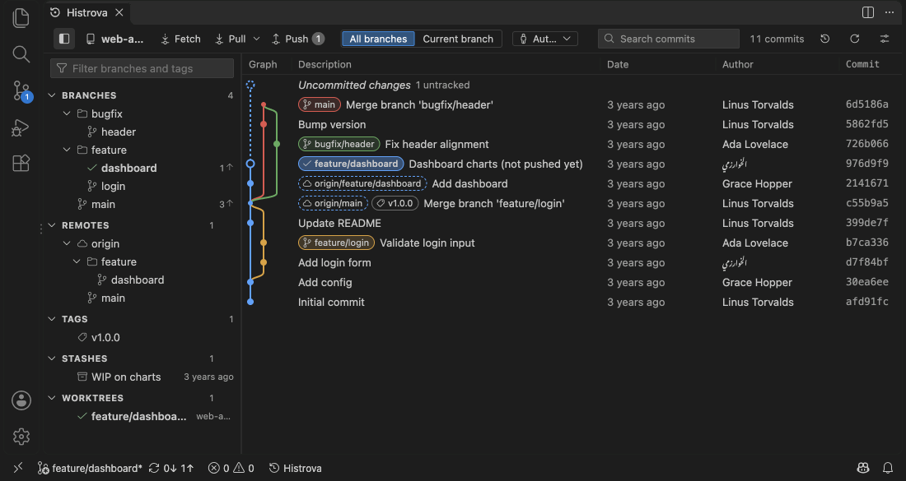
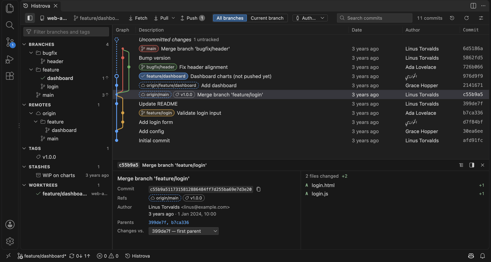
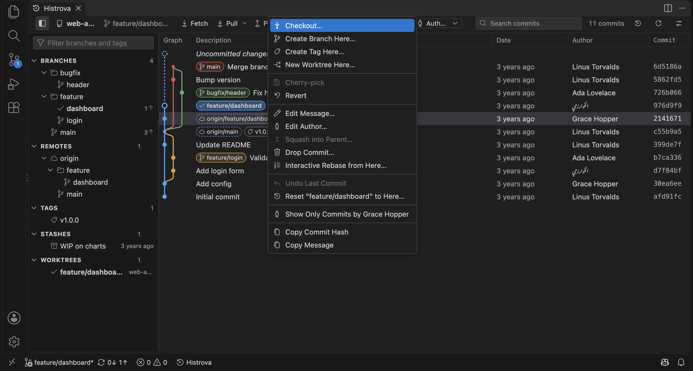
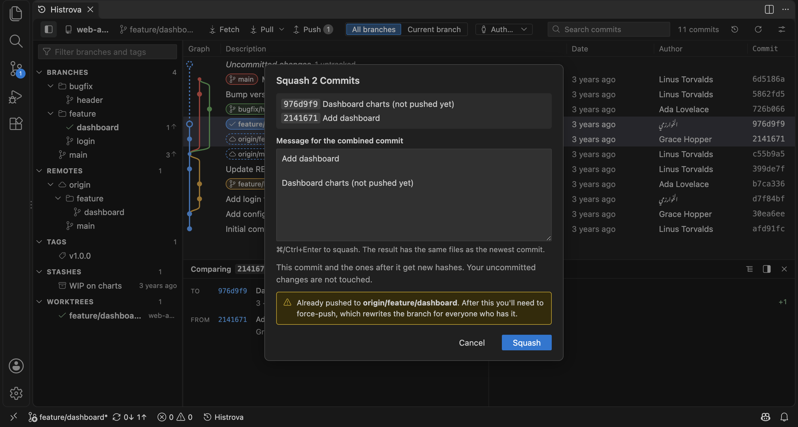
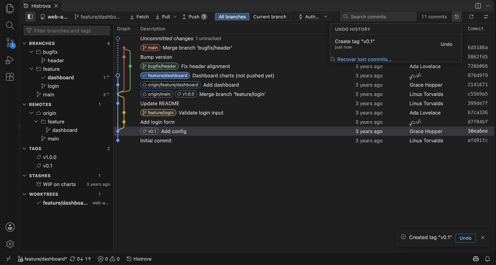
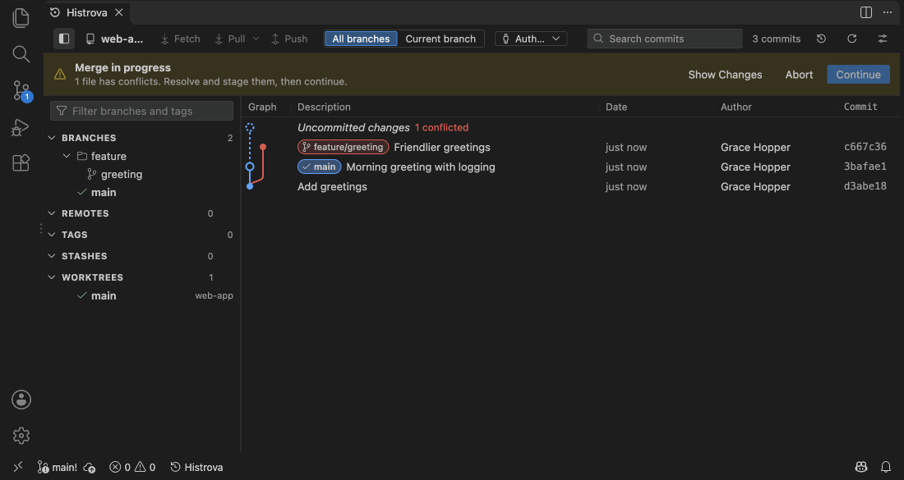
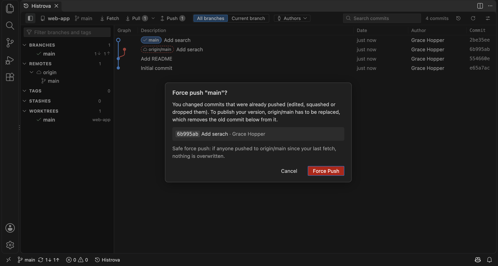

<h1 align="center">Histrova</h1>

<strong>Edit your Git history without fear.</strong> 
A fast Git graph with one-click history editing, undo for everything, and a side-by-side conflict solver. 
For Visual Studio Code.

  <a href="https://marketplace.visualstudio.com/items?itemName=histrova.histrova-app">VS Code Marketplace</a> ·
  <a href="https://histrova.pages.dev">Website</a> ·
  <a href="docs/GUIDE.md">User guide</a> ·
  <a href="https://github.com/Histrova/histrova/discussions">Discussions</a>

> This repository is Histrova's home: report bugs, ask for features, follow releases and read the guide here. Histrova runs only on your computer and never uploads your code ([privacy](PRIVACY.md)).

## Why Histrova

- **A graph you can read:** every branch, tag and remote on one graph, for any repository, with no account or login. Smooth with 100,000+ commits.
- **Edit history in one click:** reword or change the author of any commit, squash, drop, reorder by dragging. No rebase to babysit.
- **Undo for everything:** every action has an Undo button, even a hard reset that threw away your uncommitted work.
- **Conflicts, side by side:** your side, theirs and the result; take a side in one click.
- **Plain-language dialogs:** what will happen, and whether it can be undone.

## Install

In VS Code, open the Extensions view (⇧⌘X / Ctrl+Shift+X), search **Histrova** and click **Install**, or install it from the [Marketplace](https://marketplace.visualstudio.com/items?itemName=histrova.histrova-app).

You need [Git](https://git-scm.com/downloads) 2.30 or newer. Then open a folder with a Git repository and click **Histrova** in the status bar.

## A closer look

Everything Histrova does, and how: the [user guide](docs/GUIDE.md).

## Feedback and help

- **Found a bug?** [Open an issue](https://github.com/Histrova/histrova/issues/new?template=bug_report.yml).
- **Want something?** [Request a feature](https://github.com/Histrova/histrova/issues/new?template=feature_request.yml), or upvote an existing request with 👍.
- **Questions and ideas:** [Discussions](https://github.com/Histrova/histrova/discussions).
- **Quick, anonymous feedback:** **Histrova: Send Feedback** from the Command Palette, or the [feedback form](https://histrova.pages.dev/#feedback).
- **A security problem?** Please report it privately: see [SECURITY.md](SECURITY.md).

## FAQ

**Does it send my code anywhere?** No. Histrova runs Git on your computer. Anonymous usage counts are off unless you turn them on. See [PRIVACY.md](PRIVACY.md).

**Which Git hosts does it work with?** Any: GitHub, GitLab, Bitbucket, Azure DevOps, your own server. Histrova uses the Git on your computer and its sign-in.

## License

Copyright © 2026 Histrova. All rights reserved. See [LICENSE.md](LICENSE.md).
